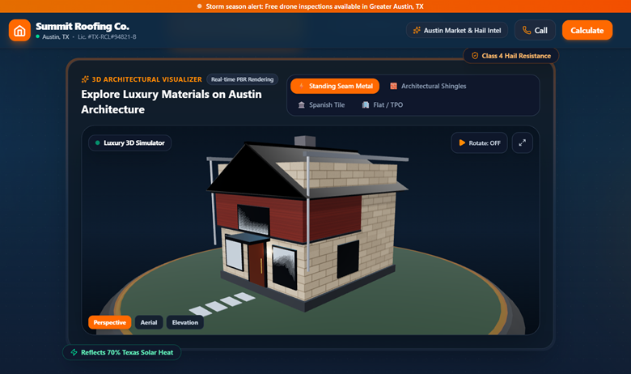
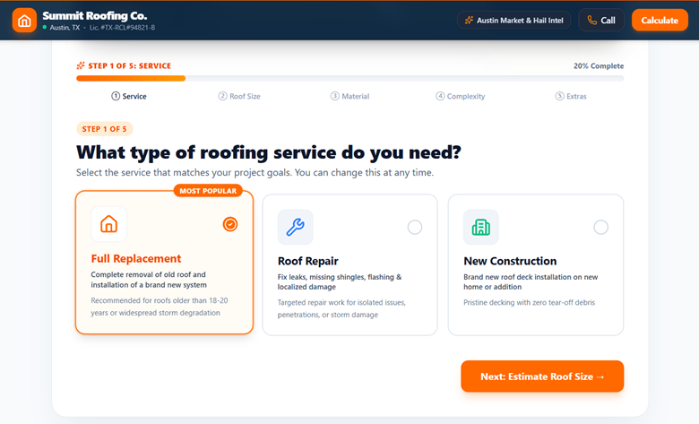
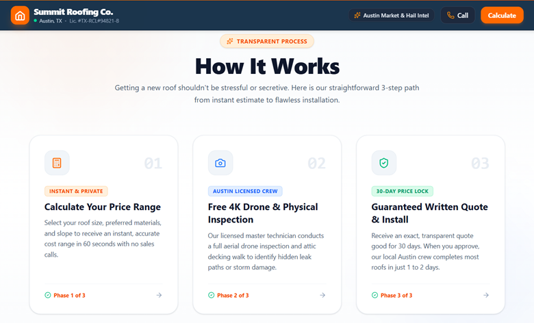

# Summit Roofing Co. — Instant Roof Cost Estimator & Lead Capture Platform

A high-converting roofing estimation platform engineered specifically for professional roofing contractors. Designed for speed, precision, and homeowner trust, it enables prospective clients to obtain an accurate, itemized cost estimate in under 60 seconds while delivering qualified, ready-to-book leads directly into your sales pipeline.

---

## Platform Screenshots

### Hero — Instant Estimate Entry Point

> A clear, frictionless entry point. No forms, no commitment — homeowners see the value proposition immediately and start their estimate with one click.

---

### Interactive 3D Architectural Visualizer

> Built with Three.js. Homeowners switch between four material types in real time — Architectural Shingles, Standing Seam Metal, Spanish Clay Tile, and Commercial TPO — while watching the roof update live. Perspective, aerial, and elevation camera modes included.

---

### 5-Step Intelligent Estimation Wizard

> A guided, step-by-step flow covering service type, roof dimensions, material selection, roof complexity, and optional add-ons. Each step is clear, non-intimidating, and builds toward a transparent line-item estimate — not a vague ballpark.

---

### Transparent 3-Phase Process Explanation

> Sets honest expectations before any contact is requested. Homeowners understand exactly what happens after they submit: a free 4K drone inspection, then a written quote locked for 30 days, then installation — with no pressure tactics.

---

## Executive Overview

For roofing companies, the primary bottleneck in online customer acquisition is friction: traditional forms ask for too much before offering value, while generic online calculators produce unrealistic numbers that erode trust.

This platform bridges that gap by offering:
- **Transparent, Realistic Pricing**: Clear line-item breakdowns based on actual roof geometry, material selections, and project complexity.
- **Interactive 3D Visualization**: Real-time 3D roof preview that reflects material selections (Architectural Shingles, Standing Seam Metal, Spanish Clay Tile, Commercial TPO) dynamically.
- **Seamless Lead Conversion**: An intuitive step-by-step wizard that transitions naturally from transparent pricing to scheduling a free on-site physical inspection.
- **Zero Lock-in & Complete Customization**: All rates, multipliers, municipal details, and branding can be adapted to any local contractor or market in minutes.

---

## Key Architectural Features

### 1. Step-by-Step Intelligent Estimation Wizard
Guides homeowners through an intuitive, frictionless 5-step process:
- **Service Type**: Full roof replacement, leak/storm repair, or new construction.
- **Roof Dimensions**: Homeowners can enter ground square footage (with automatic pitch-factor calculation) or exact roof surface square footage.
- **Architectural Materials**:
  - Architectural Asphalt Shingles (Class 3 / Class 4 impact resistance)
  - Standing Seam Metal (Cool roof reflectivity, 50+ year durability)
  - Spanish Clay / Concrete Tile (High wind load and thermal mass)
  - Commercial Flat / TPO Membrane (Single-ply heat-welded commercial grade)
- **Roof Complexity & Geometry**: Accounts for story height (1-story, 2-story, 3+ stories) and pitch severity (low, medium, steep slopes).
- **Project Add-Ons & Site Preparation**: Tear-off of existing layers, seamless aluminum gutters, skylight replacement/flashing, radiant barrier thermal sheathing, and emergency tarping.

### 2. Interactive 3D Architectural Viewer
- Built with **Three.js** to give homeowners immediate tactile feedback as they switch between materials, slope profiles, and roof styles.
- Procedural textures generated client-side for ultra-fast load times with zero heavy asset downloads.

### 3. Transparent Range Estimator
- Provides a realistic price band (`-12%` to `+15%`) rather than a single misleading number, setting honest expectations for homeowners and protecting contractor margins.
- Displays full cost components: estimated materials, skilled labor & installation, tear-off/prep, and selected accessories.

### 4. Contractor CRM & Lead Routing
- Direct lead submission endpoint (`/api/submit-lead`) with webhook dispatch to any CRM (Zapier, Make, Formspree, HubSpot, JobNimbus, or Google Sheets).
- Embedded Admin Lead Management dashboard (`?admin` mode) with offline persistence and real-time Supabase sync capabilities.
- Captured lead payloads include complete project scope: square footage, selected materials, story height, calculated price ranges, contact details, inspection time preferences, and homeowner notes.

### 5. Local Market Intelligence
- Optional localized weather and permitting intelligence module, allowing contractors to showcase recent hail/storm activity and local municipal building codes to reinforce authority.

---

## Technology Stack

| Layer | Technology |
|---|---|
| **Frontend Framework** | React 19 + TypeScript |
| **Styling & Design System** | Tailwind CSS v4 + Framer Motion |
| **3D Graphics Engine** | Three.js |
| **Icons & Visuals** | Lucide React |
| **Build Tool & Bundler** | Vite 8 |
| **Backend & Lead Processing** | Node.js / Express + Vercel Serverless Functions |
| **Persistence / CRM** | Supabase (Client & Server) + Webhook dispatcher |
| **Testing Suite** | Vitest (Calculation & pricing unit tests) |

---

## Contractor Onboarding & Rebranding

Deploying this solution for any roofing business or municipal market requires modifying **only one configuration file**:

`src/config/roofingConfig.ts`

```ts
export const roofingConfig: AppConfig = {
  brand: {
    companyName: 'Lone Star Premier Roofing',
    city: 'Dallas, TX',
    phone: '(214) 555-0188',
    ownerEmail: 'quotes@lonestarpremier.com',
    licenseNumber: 'TX-RCL#88412',
    primaryColor: '#0F2A43', // Contractor Navy
    accentColor: '#F97316',  // Accent Safety Orange
    webhookUrl: 'https://formspree.io/f/your_form_id', // Lead webhook endpoint
  },
  pricing: {
    lowVariancePercentage: 0.12,
    highVariancePercentage: 0.15,
    materialPerSqFt: {
      asphalt: { basePricePerSqFt: 5.25, ... },
      metal: { basePricePerSqFt: 10.75, ... },
      tile: { basePricePerSqFt: 12.50, ... },
      tpo: { basePricePerSqFt: 6.80, ... },
    },
    serviceMultipliers: { replacement: 1.0, repair: 0.35, new_construction: 0.92 },
    storiesMultipliers: { 1: 1.0, 2: 1.15, 3: 1.30 },
    pitchMultipliers: { low: 1.0, medium: 1.08, steep: 1.25 }
  }
};
```

---

## Lead Payload Schema

When a prospect books an inspection, the platform dispatches structured JSON containing both client information and exact calculation parameters:

```json
{
  "lead": {
    "name": "Sarah Jenkins",
    "phone": "(512) 555-0199",
    "email": "sarah@example.com",
    "address": "1402 Barton Springs Rd, Austin, TX",
    "preferredTime": "Morning (8:00 AM - 12:00 PM)",
    "notes": "Hail storm damage on back ridge."
  },
  "estimate": {
    "input": {
      "service": "replacement",
      "squareFeet": 2200,
      "material": "asphalt",
      "stories": 1,
      "pitch": "medium",
      "extras": ["tear_off", "gutters"]
    },
    "breakdown": {
      "estimatedLow": 12850,
      "estimatedHigh": 16800,
      "subtotal": 14600
    }
  }
}
```

---

## Quality Assurance & Mathematical Testing

To ensure absolute calculation integrity and prevent margin discrepancies, the pricing algorithm is validated with a dedicated Vitest test suite:

```bash
npm test
```

Tests cover:
- Multiplier compound formulas
- Pitch factor square footage translations
- Flat vs. per-square-foot extra charges
- Floating-point financial rounding stability

---

## Local Development & Deployment

### Quick Start
```bash
# 1. Install dependencies
npm install

# 2. Start development server
npm run dev
```

### Production Build
```bash
npm run build
npm run preview
```

### Deploying to Vercel
1. Import this repository into Vercel.
2. Framework Preset: **Vite**.
3. Build Command: `npm run build`.
4. Output Directory: `dist`.
5. Deploy.

---

## License & Attribution

Designed and engineered by **[ScaleUp Dynamics](https://github.com/scaleup-dynamics)** for commercial client deployment. All rights reserved.
